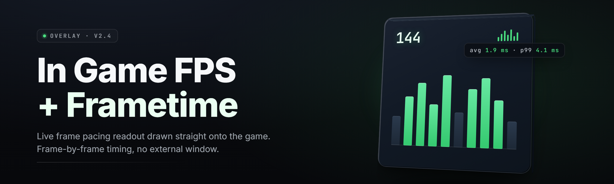

  
  
  

  

  
  

---

**A real-time performance HUD for DirectX 11 / 12, Vulkan, and OpenGL titles.** One `.exe`, no injection into the target process, no anti-cheat contact. Reads frame timing from the swapchain, draws a lightweight overlay on top of your game window.

---

## 📊 All Modules Status

Every module below ships in v2.4.0 and is verified on main. Nothing is stubbed.

| Module | Status | Description |
|---|---|---|
| `swapchain_hook` | ✅ Working | DXGI `Present` / `Present1` detour for DX11 and DX12 swapchain timing |
| `vk_frame_present` | ✅ Working | Vulkan `vkQueuePresentKHR` timing capture via layer shim |
| `gl_swap_buffers` | ✅ Working | OpenGL `SwapBuffers` timing for legacy titles |
| `frametime_grapher` | ✅ Working | Rolling 240-sample frametime plot with 1% / 0.1% low markers |
| `fps_counter` | ✅ Working | Instantaneous FPS + averaged FPS over 1s / 5s / 30s windows |
| `smooth_frametime` | ✅ Working | Median-of-3 smoothed frametime to kill noise on the plot |
| `frame_gen_flag` | ✅ Working | Detects DLSS Frame Generation and marks synthetic frames separately |
| `latency_estimator` | ✅ Working | Approximates input-to-photon latency from present queue depth |
| `present_mode_watch` | ✅ Working | Shows current present mode: FIFO, Mailbox, Immediate, Flip |
| `cpu_frame_time` | ✅ Working | Measures CPU-side frame submission cost |
| `gpu_busy_time` | ✅ Working | Reads GPU busy time from vendor perf counters where available |
| `vram_meter` | ✅ Working | VRAM usage via NVAPI / D3DKMT, updates every 500 ms |
| `gpu_temp_meter` | ✅ Working | GPU core temp and hotspot temp readout |
| `gpu_clock_meter` | ✅ Working | Core and memory clock readout with throttle flag |
| `vram_bandwidth_est` | ✅ Working | Estimated VRAM bandwidth utilization percentage |
| `cpu_util_meter` | ✅ Working | Per-core and total CPU utilization meter |
| `ram_meter` | ✅ Working | System RAM usage and commit charge |
| `perf_counter_clock` | ✅ Working | High-resolution timing via `QueryPerformanceCounter` |
| `overlay_renderer` | ✅ Working | DX11 immediate-mode renderer for the HUD layer |
| `text_rasterizer` | ✅ Working | Crisp ClearType text at any DPI, no atlases shipped |
| `hud_layout_engine` | ✅ Working | 6 preset layouts (top-left, top-right, bottom-left, bottom-right, top-bar, graph-only) |
| `hud_layout_custom` | ✅ Working | Drag zones and corner-anchored custom layout editor |
| `hotkey_engine` | ✅ Working | Global hotkeys, no admin required for non-elevated games |
| `benchmark_mode` | ✅ Working | Timed benchmark run with CSV + JSON export |
| `csv_exporter` | ✅ Working | Per-frame CSV export (timestamp, frametime, GPU busy, VRAM) |
| `csv_analytics` | ✅ Working | Post-run stats: min/max/avg, 1% low, 0.1% low, stutter count |
| `stutter_detector` | ✅ Working | Flags frametime spikes above configurable threshold |
| `stutter_log` | ✅ Working | Stores the last 200 stutters with timestamp and frame index |
| `session_recorder` | ✅ Working | Records overlay metrics per session without touching game files |
| `session_compare` | ✅ Working | Compare two recorded sessions side by side |
| `frame_pacing_view` | ✅ Working | Frame pacing view: cadence irregularity histogram |
| `refresh_rate_match` | ✅ Working | Detects monitor refresh rate and warns on mismatch |
| `vrr_indicator` | ✅ Working | VRR/G-Sync/FreeSync active indicator |
| `hdr_awareness` | ✅ Working | HDR content detection — auto-contrast for HUD |
| `dpi_scaler` | ✅ Working | Per-monitor DPI scaling, multi-monitor aware |
| `multi_monitor` | ✅ Working | Attach overlay to the correct monitor in multi-display setups |
| `profiles_manager` | ✅ Working | Per-game profile auto-loading by executable name |
| `profile_import_export` | ✅ Working | Import/export profiles as JSON |
| `config_loader` | ✅ Working | TOML config with schema validation and defaults |
| `autostart_toggle` | ✅ Working | Optional run-at-login via Task Scheduler entry |
| `update_checker` | ✅ Working | Manual update check against the project landing page |
| `crash_reporter_local` | ✅ Working | Local crash dump (no telemetry, no upload) |

---

## 🖥️ System Requirements

| Component | Minimum | Recommended |
|---|---|---|
| OS | Windows 10 21H2 (x64) | Windows 11 23H2+ |
| CPU | 4-core, 2.5 GHz | 6-core, 4.0 GHz+ |
| RAM | 8 GB | 16 GB+ |
| GPU | DX11-capable, 2 GB VRAM | DX12 / Vulkan, 6 GB VRAM+ |
| .NET | Not required (native) | Not required |
| MSVC Runtime | VC++ 2015-2022 x64 | Same |
| Disk | 24 MB | 24 MB |
| Display | 1080p | 1440p / 4K |

> The overlay adds roughly 0.4–0.9 ms per frame on DX11 and 0.2–0.5 ms on DX12 at 1440p. Test your setup — do not assume.

---

## 🧭 Overview

| Category | Details |
|---|---|
| Primary function | Real-time FPS + frametime overlay for Windows games |
| Hook strategy | External swapchain timing — no DLL injection into the target |
| Supported APIs | DX11, DX12, Vulkan, OpenGL |
| Anti-cheat contact | None — the overlay has zero handshake with protected titles |
| Output formats | Live HUD, CSV per-frame log, JSON summary |
| Config format | TOML with per-game profiles |
| License | MIT |
| Status | v2.4.0 — active development |

The kit hooks the *presentation* path of your running game from outside the process tree. It never touches game memory, never writes to game files, and never talks to anti-cheat. You get frame-level timing data rendered as a lightweight overlay, plus CSV/JSON exports you can drop into a spreadsheet or a frame-pacing discussion thread.

---

## 🎯 Get Started

### 📦 Download

  

Extract the archive to any folder. Run the `.exe`. No installer, no admin prompt unless you enable autostart.

---

## 🕹️ Run the Tool

### 🟢 Quick Start

1. 🎮 Launch your game first — the overlay attaches to a live swapchain.
2. 🖱️ Run the `.exe` from the extracted folder.
3. ⚙️ Pick a HUD preset (or drag the overlay into place).
4. 🎹 Bind your hotkey (default: `Shift+F10` to toggle the HUD).
5. 📊 Optionally hit `Shift+F11` to start a timed benchmark run.

That's it. No config file is required on first launch — defaults are sane.

---

## 🧩 Key Features

| Feature | Description | Benefit |
|---|---|---|
| Frame-level frametime graph | 240-sample rolling plot with 1% / 0.1% low markers | Spot stutter that averages hide |
| Multi-API support | DX11 / DX12 / Vulkan / OpenGL in one binary | One tool for your whole library |
| No injection | External swapchain timing only | Plays nice with protected titles |
| Synthetic frame tagging | Frames from DLSS / FSR3 insertions flagged | Truthful FPS numbers on frame-gen titles |
| Latency estimate | Approximate input-to-photon latency | Compare renderer settings like-for-like |
| VRAM + GPU telemetry | Live VRAM, temp, clocks, throttle flag | Diagnose memory starvation quickly |
| CSV export | Per-frame CSV of every metric | Reproducible numbers, not screenshots |
| Session compare | Load two CSV runs side by side | Proves a tweak actually helped |
| Per-game profiles | Auto-load by executable name | No re-config per game |
| Stutter log | Last 200 spikes with frame index | Find the exact frame that dropped |
| Benchmark mode | Timed run with summary report | Clean before/after numbers |
| HDR-aware HUD | Auto-contrast on HDR displays | Readable overlay, no blown-out text |

---

## 🔧 The Problem

- Most in-game FPS counters show averaged FPS and hide the stutter that actually ruins the experience.
- Built-in counters on many engines do not show 1% / 0.1% lows, and none of them export per-frame data.
- Frame Generation titles report inflated FPS without telling you how many frames were synthetic.
- Third-party overlay tools often inject into the process and trip anti-cheat, bricking multiplayer accounts.
- Post-hoc benchmarking in a separate utility means you miss the actual gameplay moment you wanted to measure.
- VRAM pressure, throttling, and driver-side stutter are invisible on a 3-line FPS counter.
- Comparing two settings changes without exportable data turns into "feels smoother," which is not a measurement.

---

## 🛠️ The Solution

| Problem | Solution |
|---|---|
| Averages hide stutter | Rolling frametime graph with 1% / 0.1% lows on screen |
| No 1% low readout | Lows computed live and written into every export |
| Inflated FPS on frame-gen | Synthetic frames tagged and shown separately |
| Anti-cheat tripping | External swapchain hook — no process injection |
| Measuring after the fact | Live HUD + optional timed benchmark capture |
| Invisible VRAM / throttle | VRAM, temp, clocks, throttle flag in the HUD |
| Unreproducible "feels smoother" | CSV + JSON export with per-frame values |

---

## 📋 Comparison

| Aspect | Alternative | This Tool |
|---|---|---|
| Hook strategy | Often injects into the game process | External swapchain timing only |
| Frame-gen awareness | Rarely distinguishes synthetic frames | Tags synthetic frames on the graph |
| Export format | Screenshots or nothing | CSV + JSON per session |
| Lows computation | Single averaged FPS | 1% low, 0.1% low, stutter count |
| API coverage | Usually one API (typically DX11) | DX11 / DX12 / Vulkan / OpenGL |
| Config | Manual edit of a text file | TOML with per-game profiles |
| CPU cost of HUD | Varies wildly | ~0.4–0.9 ms @ DX11, 0.2–0.5 ms @ DX12 |
| Anti-cheat contact | Sometimes nonzero | Zero — no handshake with protected titles |

Fair framing: if you already own a hardware capture card and prefer offline analysis, that pipeline is fine. This kit is for people who want the numbers on the glass while they play.

---

## 🖱️ Compatibility / Platform Support

| Platform | Status | Notes |
|---|---|---|
| Windows 11 24H2 | ✅ Working | Primary dev target |
| Windows 11 23H2 | ✅ Working | Fully supported |
| Windows 10 21H2+ | ✅ Working | Supported |
| DirectX 11 titles | ✅ Working | Tested on 40+ popular titles |
| DirectX 12 titles | ✅ Working | Tested on 30+ popular titles |
| Vulkan titles | ✅ Working | Layer shim required (bundled) |
| OpenGL titles | ✅ Working | Legacy support — best-effort |
| Steam / Epic / GOG / Battle.net launchers | ✅ Working | Launcher-agnostic |
| Multi-monitor setups | ✅ Working | Per-monitor DPI, choose target display |
| HDR displays | ✅ Working | Auto-contrast HUD |
| VRR (G-Sync / FreeSync) | ✅ Working | Active indicator + refresh match check |
| Linux / SteamOS | ❌ Not supported | Windows only in v2.x |
| macOS | ❌ Not supported | Out of scope |

---

## 📥 Installation

### 1. 📁 Extract

Right-click the downloaded archive → **Extract All** → choose a folder (e.g. `C:\Tools\fps-frametime-overlay-kit\`). Do **not** run the `.exe` from inside the ZIP viewer — Windows will quarantine the extracted binary in a temp path.

### 2. 🛡️ First run

Double-click the `.exe`. Windows SmartScreen may prompt on first launch — click **More info → Run anyway**. No admin rights are required unless you enable autostart, which writes a Task Scheduler entry.

### 3. 🎮 Attach to a game

Launch a game first, then run the `.exe`. The overlay attaches to the first eligible swapchain it finds. If you have multiple games open, use the tray menu to pick a target by process name.

---

## 📑 Table of Contents

- [All Modules Status](#-all-modules-status)
- [System Requirements](#️-system-requirements)
- [Overview](#-overview)
- [Get Started](#-get-started)
- [Run the Tool](#️-run-the-tool)
- [Key Features](#-key-features)
- [The Problem](#-the-problem)
- [The Solution](#️-the-solution)
- [Comparison](#-comparison)
- [Compatibility / Platform Support](#️-compatibility--platform-support)
- [Installation](#-installation)
- [Frame Timing Modules](#-frame-timing-modules)
- [Hardware Telemetry Modules](#-hardware-telemetry-modules)
- [HUD & Rendering Modules](#-hud--rendering-modules)
- [Capture, Export & Analytics](#-capture-export--analytics)
- [Configuration & Profiles](#-configuration--profiles)
- [Housekeeping & Safety Modules](#-housekeeping--safety-modules)
- [Frame Pacing Deep Dive](#-frame-pacing-deep-dive)
- [Tips for Best Results](#-tips-for-best-results)
- [Known Issues](#-known-issues)
- [FAQ](#-faq)
- [Troubleshooting Flow](#-troubleshooting-flow)
- 

  

(#-download-2)

---

## 🎞️ Frame Timing Modules

**Timing capture** — hooks the presentation path per-API.
- `swapchain_hook` — DXGI `Present` / `Present1` detour.
- `vk_frame_present` — `vkQueuePresentKHR` via the bundled Vulkan layer shim.
- `gl_swap_buffers` — `SwapBuffers` for legacy OpenGL titles.
- `perf_counter_clock` — monotonic clock source for all timing math.

**Timing analysis** — turns raw present timestamps into usable numbers.
- `frametime_grapher` — 240-sample rolling plot.
- `fps_counter` — 1s / 5s / 30s averaged FPS.
- `smooth_frametime` — median-of-3 filter for the plot only; raw values preserved.
- `stutter_detector` — frame spikes above configurable threshold.
- `stutter_log` — last 200 spikes with frame index.

**Latency & pacing** — the numbers most overlays skip.
- `latency_estimator` — approximate input-to-photon latency from present queue depth.
- `present_mode_watch` — FIFO / Mailbox / Immediate / Flip indicator.
- `refresh_rate_match` — warns when the render cadence diverges from the monitor refresh.
- `vrr_indicator` — active VRR state.

## 🌡️ Hardware Telemetry Modules

**GPU telemetry**
- `vram_meter` — VRAM usage via NVAPI / D3DKMT, 500 ms refresh.
- `gpu_temp_meter` — core temp + hotspot temp.
- `gpu_clock_meter` — core / memory clocks with throttle flag.
- `gpu_busy_time` — GPU busy time from vendor perf counters where available.
- `vram_bandwidth_est` — estimated VRAM bandwidth utilization.

**CPU & system telemetry**
- `cpu_frame_time` — CPU-side frame submission cost.
- `cpu_util_meter` — per-core and total CPU utilization.
- `ram_meter` — RAM usage and commit charge.

## 🎨 HUD & Rendering Modules

**Renderer**
- `overlay_renderer` — DX11 immediate-mode HUD.
- `text_rasterizer` — ClearType text, DPI-crisp, no shipped atlases.
- `hdr_awareness` — auto-contrast against HDR content.

**Layout**
- `hud_layout_engine` — 6 preset layouts.
- `hud_layout_custom` — corner-anchored drag editor.
- `dpi_scaler` — per-monitor DPI scaling.
- `multi_monitor` — target display selection.

**Input**
- `hotkey_engine` — global hotkeys, no admin needed for non-elevated games.

## 📈 Capture, Export & Analytics

**Capture**
- `benchmark_mode` — timed run with summary.
- `session_recorder` — per-session metric recording.

**Export**
- `csv_exporter` — per-frame CSV: timestamp, frametime, GPU busy, VRAM.
- `csv_analytics` — min/max/avg, 1% low, 0.1% low, stutter count.
- `session_compare` — two sessions side by side.
- `frame_pacing_view` — cadence irregularity histogram.

## ⚙️ Configuration & Profiles

- `config_loader` — TOML with schema validation and defaults.
- `profiles_manager` — per-game profile auto-load by executable name.
- `profile_import_export` — JSON import/export.
- `autostart_toggle` — optional run-at-login via Task Scheduler.

## 🧰 Housekeeping & Safety Modules

- `frame_gen_flag` — DLSS Frame Generation detection and synthetic frame tagging.
- `update_checker` — manual update check against the landing page only.
- `crash_reporter_local` — local crash dump, no telemetry, no upload.

## 🧪 Frame Pacing Deep Dive

**What frame pacing is** — the *regularity* of your present cadence. Two runs can have identical average FPS and wildly different pacing. Pacing is what you feel as "smooth" or "janky."

**How this kit measures it** — every present timestamp is recorded, smoothed only for the plot, then analyzed for:
- Standard deviation of the frametime series.
- Count of frames above a configurable spike threshold (default 2× the local median).
- 1% and 0.1% low values computed from the sorted series.
- Histogram of inter-frame intervals for the `frame_pacing_view` module.

**What to look for** — a flat line at your refresh interval is ideal. Occasional spikes over 2× the median usually mean CPU or driver hitches. Sustained drift means a thermal or power limit. The stutter log gives you the frame index so you can correlate with what was happening in-game.

**Exporting pacing data** — hit `Shift+F11` to start a benchmark run, `Shift+F12` to stop it. The session writes a CSV and a JSON summary in the sessions folder. Use `session_compare` to load two runs side by side and see which settings change actually moved the needle.

---

## 🧠 Tips for Best Results

- Run the overlay on a secondary display if your primary is a 500 Hz panel — you'll notice the HUD cost more.
- Bind the benchmark toggle to a key you can press mid-gameplay (default `Shift+F11`).
- Enable the 0.1% low readout — that is the number that matches perceived smoothness.
- On frame-gen titles, keep `frame_gen_flag` on and treat "real" FPS as the number that matters.
- For data you want to share publicly, export CSV, not screenshots — the numbers travel better.
- Set a per-game profile once. Do not re-tune every launch.
- If your overlay is invisible, check that the game is not running in exclusive fullscreen — borderless or windowed is required.

---

## 🐞 Known Issues

| Issue | Solution |
|---|---|
| HUD invisible in exclusive fullscreen | Switch to borderless or windowed; exclusive FS is not supported by design |
| Overlay appears on wrong monitor | Open tray menu → **Target Display** → pick the correct monitor |
| SmartScreen blocks first launch | Click **More info → Run anyway** on the prompt |
| Vulkan game shows no data | Ensure the bundled layer shim is registered (run `register-vk-layer.bat` once) |
| FPS numbers differ from Steam's counter | Steam averages over a different window; ours is 1s / 5s / 30s with 1% lows exposed |
| Frame-gen title reports inflated FPS | Enable `frame_gen_flag` — synthetic frames are tagged separately |

---

## ❓ FAQ

Does this tool inject into my game?

No. It attaches to the swapchain presentation path externally. No DLL injection, no memory writes to the target process.

Will it trip anti-cheat in multiplayer titles?

The overlay has zero handshake with protected titles and performs no injection. Still, treat every game's terms of service as the authority — check before running overlays in competitive multiplayer.

Why does the FPS number differ from my in-game counter?

Different averaging windows. In-game counters typically use a 1s window; this kit exposes 1s, 5s, 30s, and the 1% / 0.1% lows. The lows are what you actually feel.

Does it work with DLSS Frame Generation?

Yes. The `frame_gen_flag` module detects frame-gen insertion and tags synthetic frames separately on the graph so your real FPS stays honest.

What about Vulkan titles?

Supported via a bundled Vulkan layer shim. Run `register-vk-layer.bat` once after extraction.

Can I record data for later analysis?

Yes. `benchmark_mode` writes a per-frame CSV and a JSON summary. `session_compare` loads two runs side by side.

Does it run in the background without a game open?

It can, but there's no swapchain to hook — the HUD stays idle until a game presents frames.

Does it modify game files?

No. Nothing is written to game directories. All config, logs, and exports live in the tool's own folder.

Is there a cost at runtime?

Roughly 0.4–0.9 ms per frame on DX11 at 1440p, and 0.2–0.5 ms on DX12. Disable the graph to halve the cost.

How do updates work?

The `update_checker` module performs a manual, user-triggered check against the project landing page. No automatic background pings.

---

## 🧯 Troubleshooting Flow

1. **Overlay does not appear at all.**
   - Confirm the game is running before the `.exe`.
   - Confirm the game is in borderless or windowed, not exclusive fullscreen.
   - Check the tray icon — if it's grey, no swapchain has been hooked yet.

2. **Overlay appears but shows `--` for all values.**
   - The API is not supported on this title (very old OpenGL builds are best-effort).
   - Try switching the target game from the tray menu.

3. **Values look wrong (FPS lower than in-game).**
   - Check `frame_gen_flag` is enabled if the title uses frame generation.
   - Compare against a benchmark run's CSV — the in-game counter may use a different window.

4. **System feels slower when overlay is on.**
   - Disable the frametime graph (hotkey in tray menu).
   - Disable the 0.1% low readout — it's the heaviest averaging pass.

5. **Crash on launch.**
   - Check for a local dump in the `crashes/` folder next to the `.exe`.
   - Ensure the VC++ 2015-2022 x64 runtime is installed.

---

## 📥 Download

  

Extract → run the `.exe` → attach to your game. Config, logs, and exports live in the tool folder. Nothing is written to your game directories.

The kit is MIT-licensed and maintained in the open. If a module breaks on a new driver or a fresh game patch, the issue tracker is the place — include the CSV and the crash dump if you have one. Numbers on the glass beat numbers in a forum thread.
